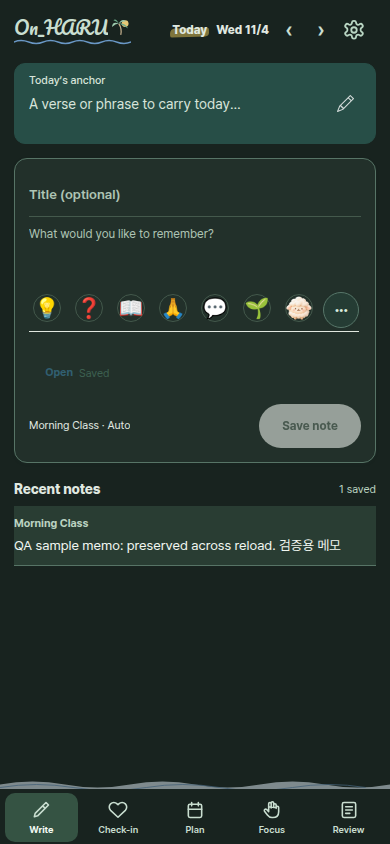
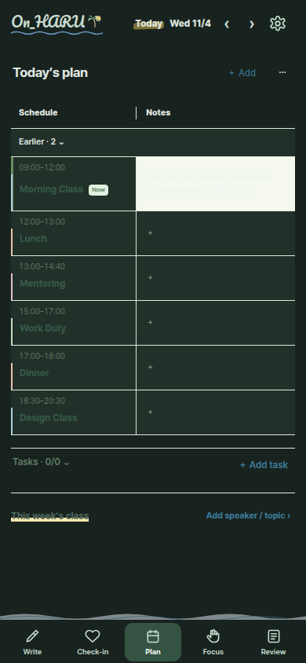
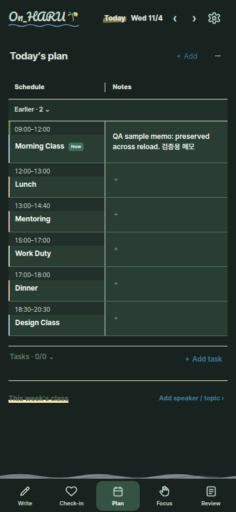

# 전후 스크린샷

390px dark, 격리 Chromium의 가상 데이터. 전: 초기 감사의 기준 CSS, 후: 최종 후보 090ffb6. 서로 다른 테스트 실행이므로 시각·샘플 기록 수는 다를 수 있다. 실제 사용자 기록은 없다.

| 화면 | 수정 전 | 수정 후 |
| --- | --- | --- |
| Capture |  |  |
| Plan |  |  |

전체 320/390/1024px light/dark 화면은 [최종 후보 테스트 artifact](https://github.com/laml6732-spec/On_haru/actions/runs/41970956710)에 있다.
